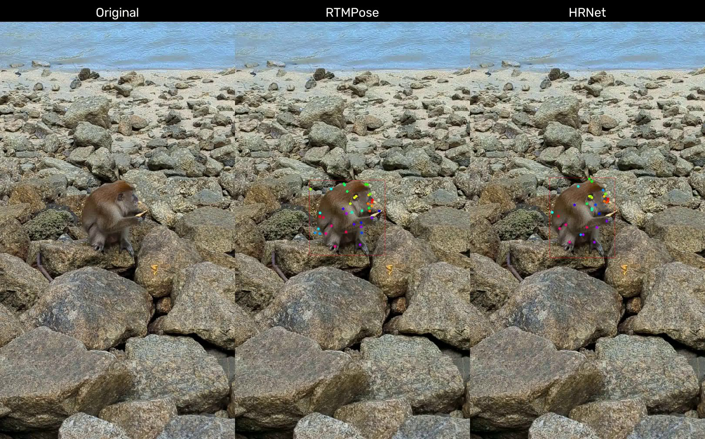

# Animal Pose Detection

## Environment Setup
To create an environment on Anaconda, please refer to below:
```text
# Clone the repository
git clone https://github.com/ChuinHongYap/Animal_Pose.git
cd Animal_Pose

# Create and activate a virtual or conda environment
conda create -n pose-env python=3.11 -y
conda activate pose-env

# Install dependencies
pip install -r requirements.txt
```

## DeepLabCut

DeepLabCut video inference comparison showing pose estimation results on a macaque. The original video (left) is compared with RTMPose (centre) and HRNet (right), with predicted keypoints and bounding boxes overlaid on each frame.

<a href="./videos/monkeys_compare.mp4">
  
</a>

